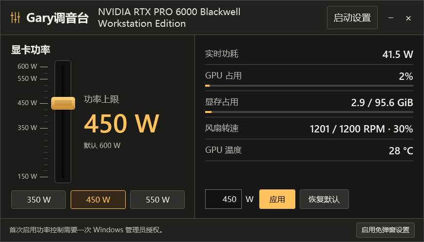

# Gary调音台

Gary调音台是一个轻量的 Windows 托盘工具，用来调整 NVIDIA 显卡的功率上限。可以点选 **350 / 450 / 550 W**，也可以拖动推子、输入瓦数或恢复驱动默认值。

[下载 1.0](https://github.com/oaaaaaaooo237/GaryMixer/releases/tag/v1.0)

## 使用

1. 运行 `GaryMixerSetup.exe`，在安装时确认一次 Windows 管理员授权。安装器会配置后台任务，并用普通权限验证功率设置。
2. 安装验证通过后，日常切换功率无需再次确认 UAC。关闭窗口会缩到托盘，点击托盘图标可恢复。
3. 如需登录后自动调节，在「启动设置」中勾选「登录 Windows 时启动到托盘」和「启动时自动应用」，输入瓦数并保存。也可以在任务管理器的「启动应用」中开关登录启动。

`GpuPowerTray.exe` 是便携版，可以直接运行。首次使用调节功能时，需要在程序内启用免弹窗设置。

## 兼容性

需要 Windows x64、.NET Framework 4.8 和支持写入功率上限的 NVIDIA 驱动。程序按驱动报告的范围校验瓦数。功率、显存、GPU 占用、温度和风扇百分比通过 `nvidia-smi` 读取。驱动支持时，通过 NVIDIA NVML 显示每把风扇的 RPM。

遥测已在 RTX PRO 6000 Blackwell Workstation Edition 上对照验证。其他显卡的可用档位取决于驱动和硬件。

## 构建

在 Windows PowerShell 中运行 `./Build.ps1`。使用系统的 .NET Framework 编译器，输出安装包和便携版。
